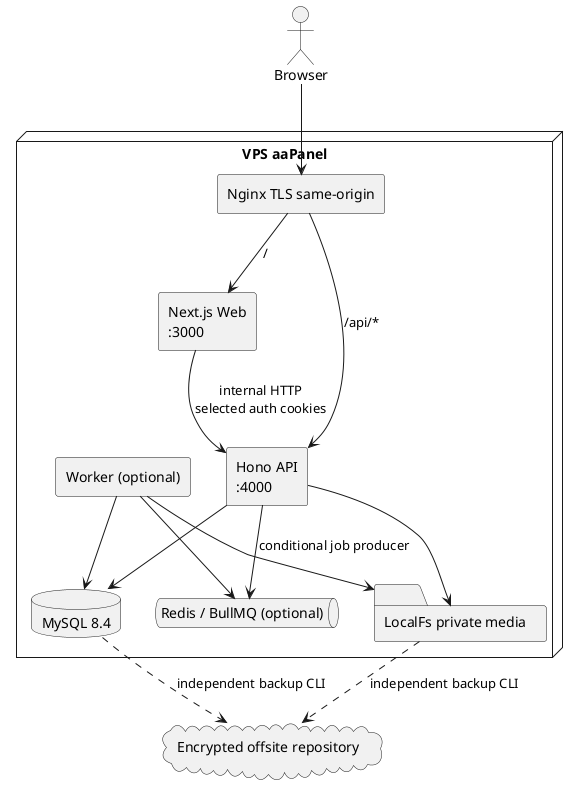

# SPEC-001-app-starter-kit-modular-core

**Versi:** 2.0 (draft implementasi disepakati) · **Tanggal:** 2026-11-14
**Baseline:** repo saat ini Next.js preview; seluruh kapabilitas di bawah merupakan target, bukan kode yang telah terverifikasi.

## Background

App Starter Kit merupakan fondasi aplikasi single-tenant yang di-*clone* untuk dashboard bisnis, CRM, inventory, dan website perusahaan. Desain awal menyatukan CMS, worker, Redis, backup UI, dan restore sebagai satu MVP. Keputusan revisi: rilis Core terlebih dahulu, dengan modul Media, CMS, Operations yang opsional dan terverifikasi independen. Infrastruktur produksi tetap VPS aaPanel + Nginx + PM2, tanpa Docker, installer, atau project generator.

## Requirements

**MoSCoW — Must (Core release)**

- `CORE-01`: Single tenant per clone; konfigurasi modul statis, build/deploy ulang untuk aktivasi.
- `CORE-02`: Next.js 16 App Router + Hono Node API; browser same-origin `/api/*` via Nginx; web server berbicara ke Hono melalui HTTP internal.
- `AUTH-REQ-01..04`: Better Auth; disabled signup; invitation-first; status akun; password reset; forced password change; session revocation.
- `USER-REQ-01..02`, `RBAC-REQ-01..03`: multi-role union, deny-by-default, super-admin protection, limited delegation, P0 negative tests.
- `CORE-03`: MySQL 8.4 / Drizzle; satu schema seluruh modul dan satu migration journal; checked-in SQL migrations.
- `SET-REQ-01` dan tema Core: settings typed, global branding, immutable semantic theme snapshots; per-user color mode; default Salt & Pepper.
- `CORE-04`: API request validation, structured errors, transactional audit, no-store admin, minimal health & uptime.
- `OPS-01`: CLI independen untuk backup terenkripsi offsite dan pemulihan production; tidak bergantung pada dashboard atau Redis.
- `RELEASE-01`: automatic CI, manual approved production deployment, Core release gates serta independent module certification.

**Should — Module certification (optional per clone)**

- `MEDIA-REQ-*`: private/public delivery, validation, LocalFs adapter dengan antarmuka S3-ready, lifecycle recoverable.
- `CMS-REQ-*` dan `NAV-REQ-*`: structured blocks versioned, immutable revisions, optimistic concurrency, published-only SSR tanpa persistent cache.
- `JOBS-REQ-*`: MySQL durable intent + dispatch ke BullMQ; Redis/worker hanya bila diperlukan.
- Operations UI: backup status, verification & jobs, tanpa endpoint destructive one-click production restore.

**Could**: S3 implementation, scheduled publishing, telemetry collector, CDN cache invalidation, OIDC/SSO, visual canvas builder, database PITR.

**Won't for MVP**: dynamic module toggles/dashboard installer, multi-tenant SaaS, microservices, arbitrary JSX/HTML from CMS, production restore by BullMQ auto-retry, Kubernetes.

## Method

### 1. Komponen utama



Aplikasi web/API wajib; worker dan Redis tidak boleh menjadi syarat Core-only. Semua proses Node terikat ke loopback. Hanya HTTPS publik melalui Nginx.

### 2. Static modules dan dependency validation

```ts
type ModuleId = "media" | "cms" | "operations";
const catalog = {
  media: { dependencies: [], jobs: false },
  cms: { dependencies: ["media"], jobs: false },
  operations: { dependencies: [], jobs: true }
} as const;
const enabled = { media: false, cms: false, operations: false } as const;
```

`validateModules` memeriksa ID dikenal, semua dependency aktif, graph asiklik, dan `jobs` membutuhkan REDIS_URL dan worker ketika aktif. Route Hono, Next route guard, navigasi, OpenAPI, dan permission efektif semuanya menggunakan hasil validasi **konfigurasi sama pada build/deploy**. Backend tetap merupakan enforcement akhir. Tidak ada migrasi kondisional ketika modul on/off. Menonaktifkan modul tidak menghapus tabel/media, tetapi sync mencabut grants modul secara terkontrol, dengan audit dan tanpa auto-regrant.

### 3. Package boundaries

`apps/web` hanya mengimpor contracts/UI/browser-safe registry; `apps/api` menangani routes/services/policies/repositories; `apps/worker` memakai server-only services tanpa mengimpor Hono route; `packages/database` hanya schema/driver/migrations; `packages/contracts` hanya DTO/Zod; `packages/permissions` hanya immutable code metadata; `packages/cms-blocks` memisahkan `schemas`, `renderer`, `editor`; `packages/storage` menyediakan adapter; `packages/observability` menyediakan logging contracts. Use explicit exports dan lint restricted-import rules.

### 4. Authentication dan RBAC

Better Auth memegang credentials, sessions, reset; application RBAC memegang akses bisnis; **bukan dua RBAC paralel**. Periksa `user_profiles.status = active` dan `must_change_password=false` untuk setiap API privat, serta pada flow login/Better Auth yang relevan. Signup publik ditolak. `user_profiles.status` menambahkan `invited`; bootstrap admin aktif dengan secret interaktif, email admin diberikan operator (bukan hardcoded).

`PermissionDefinition = {code,module,action,label,delegable,sensitive,isActive}`. `roles.permissions.update` dan `users.roles.assign` **tidak boleh didelegasikan**, sedangkan izin konten dapat didelegasikan hanya bila actor memilikinya, role target tidak terproteksi, user target bukan actor saat self-escalation, dan perubahan tidak menaikkan hak efektif aktor. Last-active-superadmin guard memakai transaksi dan lock serialisasi konsisten pada row role `super_admin`; semua mutasi status dan role harus menggunakan lock order yang sama. Semua perubahan sensitif diaudit pada transaksi yang sama.

### 5. Central database dan schema delta

Semua schema (termasuk 4 tabel Better Auth dari generator serta 17 tabel aplikasi) dibuat melalui satu Drizzle migration history. Jangan mengarang schema Better Auth; generate dari versi terpasang. Perubahan MySQL di `docs/architecture/DATABASE-CONTRACT.md`: permission delegasi, status invited, media lifecycle, job dispatch, CMS save key, backup verification; tambah index dan check constraints yang tersedia. MySQL DDL bukan satu transaksi atomik: gunakan checked migration + compatibility gate + expand/contract, jangan auto rollback schema.

### 6. API dan render/caching

`/api/auth/*` native Better Auth, `/api/v1/*` typed business API via Hono, `/api/health/*` health. Browser API client relatif `/api/v1`, `credentials: same-origin`; SSR memakai `API_INTERNAL_ORIGIN` dan forward *hanya* cookie autentikasi terpilih; Hono tetap mengecek sesi dan grants. CSRF/Origin untuk unsafe methods, request limits, Zod, 401/403/404/409/422 stable errors, idempotency untuk mutasi yang berisiko replay. Data admin, preview dan auth: `no-store`. Published CMS MVP: SSR tanpa persistent cache; tidak perlu webhook cache invalidation saat ini.

### 7. Modul Media/CMS

Media LocalFs di luar webroot. JPEG/PNG/WebP awal max 10 MiB, 20 MP, 1 file/request; validasi signature, decode, checksum, dan random key. `pending -> ready -> deleted` atau `failed`; public file hanya `ready` + `public`, private via RBAC, `no-store`. Rekonsiliasi filesystem/DB. Media yang direferensikan oleh *setiap* revision yang masih dipertahankan atau settings tidak boleh physically deleted.

CMS structured block registry: `{id,type,version,props}`, Zod schema + editor + renderer, tanpa skrip/HTML bebas. Save menghasilkan immutable revision via `save_key`, `request_hash`, `expectedRevisionNo`, dengan transaksi+optimistic conflict 409. Publish atomically mengubah `published_revision_id` dan `published_slug`; enforce same-page FK dan slug uniqueness. Preview private, published public SSR; CMS memerlukan Media.

### 8. Job dispatch dan recovery

API commit MySQL `system_jobs` intent `dispatch_state=pending`; dispatcher mengklaim row dengan lease, menerbitkan BullMQ menggunakan deterministic job ID, lalu menandai `sent`; replay aman walau acknowledgment crash. Worker memeriksa state terminal dan side-effect idempotency dalam MySQL; BullMQ **at least once**. Redis mati => Core tetap siap, job tertunda, subsystem jobs degraded. Restore production **tidak** berupa BullMQ job; gunakan independent operator CLI, staging validation, maintenance, cutover.

### 9. Theme, backup, monitoring

Theme immutable snapshot dalam `theme_configs`, selected pointer dalam typed `app_settings`, per-user mode dalam `user_preferences`, semantic tokens tervalidasi light/dark dan kontras WCAG AA. Core-only logo/favicon memakai static fallback tanpa Media.

Backup CLI Linux scheduler + MySQL consistent dump + immutable LocalFs objects + restic encrypted offsite. Restore ke DB/media staging baru dan verifikasi sebelum operator cutover; RPO awal 24h, RTO target 8h **belum teruji**. Status backup di MySQL bukan satu-satunya recovery catalog.

Pino JSON redacted logs, correlation ID, transactional audit, no-store admin, liveness/readiness/subsystem checks, dan uptime monitor yang berjalan di luar VPS.

## Implementation

1. `P00/P01`: konsolidasikan keputusan, tambahkan module catalog & boundary tests; pindahkan source Next.js lama dengan Git tanpa re-scaffold.
2. `P02/P03`: schema Better Auth generated, Drizzle central migrations, tests MySQL 8.4, separate users for runtime/migration/backup.
3. `P04/P05`: Better Auth lifecycle, protected account statuses, limited delegation, audit service, last-holder concurrency guard; independent security review.
4. `P06–P08`: admin shell/Core dashboard, typed API clients dan Core SSR; standard health & logs.
5. *Tarik maju pekerjaan Core dari P12/P14/P16*: typed settings+theme fallback, independent offsite backup CLI, Core-only PM2/Nginx deploy & CI gates. Pertahankan ID lama ketika masih relevan; pecah task yang berubah scope setelah review dependency DAG.
6. `P09`: Media certified independently.
7. `P10/P11`: CMS + Media certified, public SSR dan revision safety.
8. `P13`: BullMQ optional + durable dispatcher certified.
9. `P14/P15`: Operations UI and backup/restore rehearsal; production restore selalu CLI.
10. `P16`: Full clone/integration guide, active-module certifications, operator signoff.

## Milestones

| Milestone | Exit condition | Production status |
|---|---|---|
| M0 Specs frozen | 16 ADR, requirement mapping, task DAG verified | Non-production |
| M1 Core API/Security | Auth, RBAC, DB, UI, audit positive/negative tests | Non-production |
| M2 Core Production Readiness | Settings, independent backup, CI, manual deployment, security review, smoke tests | **Core releasable** |
| M3 Media | Upload/download/deletion lifecycle and abuse tests | Optional module certified |
| M4 CMS | Draft/publish/preview/slug/revision and media tests | Optional module certified |
| M5 Jobs/Operations | Redis outage/retry, offsite/restore tests | Optional module certified |
| M6 Starter Validation | Clean clone + active-module matrix + disaster rehearsal | Complete starter reviewed |

## Gathering Results

Tidak ada fitur dinyatakan selesai sebelum bukti pengujian terhadap kode yang berjalan. Rekam per rilis: approved commit SHA, module config hash, migration ID, passing CI run, negative Auth/RBAC suite, Core-only startup tanpa Redis, SSR isolation, backup snapshot + restore rehearsal, health status, dan operator approval. RPO/RTO perlu dibuktikan dengan drill; monitor uptime, backup freshness, worker pending age dan disk. Review bulanan temuan keamanan dan penghapusan task obsolete yang disetujui; jangan mengubah status/history secara otomatis.
