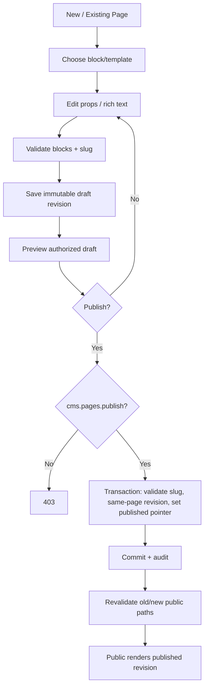
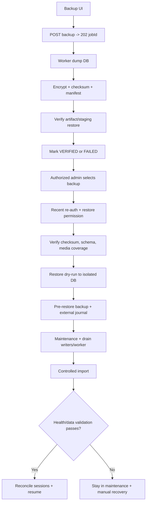

# AFD — Application Flow Documentation

**ID:** AFD-1.0 | **Status:** Implementation baseline

## AFD-01 Route map

| Route | Access | Main behavior |
|---|---|---|
| `/` and `/:slug*` | Public | Published CMS revisions only; reserved route protection |
| `/login` | Guest | Email/password, error, forgot password |
| `/forgot-password` | Guest | Rate-limited reset request |
| `/reset-password` | Token holder | Validate one-time reset token |
| `/admin` | Authenticated | Redirect to dashboard or first permitted page |
| `/admin/dashboard` | `dashboard.view` | Registry widgets restricted by permission |
| `/admin/content/pages` | `cms.pages.view` | Filtered page list, status, actions |
| `/admin/content/pages/new` | `cms.pages.create` | Page editor |
| `/admin/content/pages/:id/edit` | `cms.pages.update` | Block/editor and revision controls |
| `/admin/content/media` | `cms.media.view` | Library upload/edit/delete |
| `/admin/content/navigation` | `cms.navigation.view` | Header/footer menu editor |
| `/admin/users/list` | `users.view` | User list and role/status actions |
| `/admin/users/roles` | `roles.view` | Role list/create |
| `/admin/users/roles/:id/permissions` | `roles.permissions.update` | Grouped permission matrix |
| `/admin/settings/general` | `settings.general.view` | Branding, locale/timezone |
| `/admin/settings/appearance` | `settings.appearance.view` | Presets, colors, mode preview |
| `/admin/settings/backups` | `backups.view` | Backup list/create/verify/restore |
| `/admin/settings/audit-logs` | `audit_logs.view` | Filter/search/read audit |
| `/admin/profile` | Authenticated | Own profile/session/password |
| `/admin/change-password-required` | Password-change session | Limited first-login flow |

System routing must take precedence over CMS slug catchall. 401 for missing session on JSON APIs; 403 for authenticated but unprivileged; web may redirect to login or access denied. Avoid redirect loops for users with zero menu permissions.

## AFD-02 Login and first-time use

```mermaid
flowchart TD
 A[Open /login] --> B[Submit email/password]
 B --> C{Valid credentials?}
 C -->|No| D[Generic error and rate-limit accounting]
 C -->|Yes| E{User active?}
 E -->|No| D
 E -->|Yes| F{must_change_password?}
 F -->|Yes| G[Restricted password-change page]
 G --> H[Validate current/new password]
 H --> I[Update via Better Auth, revoke stale sessions, clear flag]
 I --> J[Sign in or refresh safe session]
 F -->|No| J
 J --> K[Load effective permissions]
 K --> L{Dashboard permitted?}
 L -->|Yes| M[/admin/dashboard]
 L -->|No| N[First allowed route or Access Denied]
```

**Error/edge cases:** bad password, inactive/suspended account, expired cookie, password reset required, too many attempts, backend unavailable, no role. Do not reveal whether account email exists. Login client must use Better Auth client and preserve SameSite/credentials behavior.

## AFD-03 Role editor and assignment

1. Admin opens Roles list → GET `/api/v1/roles`, permission `roles.view`.
2. On new role, enter display name, unique code, description. Server validates unique code and reserves `super_admin`.
3. Role editor reads `/api/v1/permissions`, groups by registry module and UI group, supports Select All by group; permissions can be individually ticked.
4. Save sends **complete replacement grant set** to `PUT /roles/:id/permissions` with expected role version/ETag to avoid overwriting someone else's work.
5. Server validates all codes active/known and actor eligibility; runs transaction, updates grants, bumps affected users' authorization versions, audits.
6. UI refetches effective permissions on access changes. Do not hardcode checkbox list or trust request list without server validation.
7. Assign roles to user via `PUT /users/:id/roles`, enforcing no self-escalation and last Super Admin rules under concurrency.
8. Success toast/updated counts; on 409 conflict prompt reload; on 403 do not mutate UI.

## AFD-04 User management

**List:** search and page/filter status/role → server query → table with loading/empty/error states.  
**Create:** admin invites user or provisions with one-time activation → account created with status + roles → no shared default password.  
**Edit:** own profile distinct from admin modifications; role assignment permission independent of user update permission.  
**Deactivate:** confirmation → invariant check → session revoke → block all subsequent protected calls → audit.  
**Reactivation:** authorized role/status change → new login required.  
**No hard delete** in MVP due audit/reference integrity.

## AFD-05 Dashboard

1. Resolve authenticated viewer and grants.
2. Render only widgets registered with matching permissions; server only serves authorized fields.
3. Default widgets: user counts, CMS published/drafts, recent audit (permission-limited).
4. Widget errors isolated; no entire dashboard crash if one metric fails.
5. Responsive skeleton/empty state; refresh or filter only on pages where API supports it.

## AFD-06 CMS page draft → publish



Saving a new revision does not affect the public pointer, SEO, title, or live slug. Unpublish clears public pointer/slug while retaining history. Restore revision creates a **new draft** from old content; never mutates old revision. Reject duplicate published slug with 409. Handle simultaneous editor conflict with `expectedRevisionNo`/ETag; retries do not double-publish.

### Preview security

Preview requires a valid admin session, `cms.pages.view` plus appropriate editor/view-draft grant, and a short-lived signed token bound to resource and intended user/session. Set no-store on draft preview; no leaked preview URL in public CMS navigation or sitemap. Preview API must not return unauthorized draft to visitors.

## AFD-07 Media upload and delete

Open media picker → choose file → client size hints → server revalidates type/signature/authorization → generate storage key → store temp/scan → DB record → rename/commit → list refresh. If DB step fails, clean orphan temp file; if storage step fails, no successful DB record. On delete, query `media_usages` and check published revision/current branding; deny referenced file; otherwise soft-delete and queue physical cleanup. Background reconciliation cleans orphan media conservatively.

## AFD-08 Public navigation

Admin opens Navigation, selects Header/Footer, adds internal page ref or validated external URL, orders items, optionally nests one level. Validate same-menu parent, no cycle, maximum depth=2. On publish, public menu renderer resolves page's current published slug; hide unpublished pages and inactive items; invalidate appropriate public menu cache after save.

## AFD-09 General and appearance settings

**General:** load typed settings → edit app name/locale/logo/favicon → validate → save with audit → invalidate branding cache → both public/admin show current settings without rebuild. Upload logo via media service, not arbitrary URL.

**Appearance:** select Salt & Pepper preset or modify semantic color tokens → preview local state → contrast/accessibility check → save global theme with revision/version → updated tokens on subsequent server render. Per-user light/dark/system preference is separate. On invalid token combination, show validation errors; no partial save.

## AFD-10 Backup and restore



Restore has an exclusive lock. Reject concurrent restore, unverified archive, incompatible schema, wrong environment, unsafe path, missing recovery space, and stale re-auth. Jobs are asynchronous; progress UI polls only authorized job. **No automatic restore retries and no implicit destructive production approval.** For failure, show reference ID and recovery instructions while retaining protected logs.

## AFD-11 Common states

| State | UX / API requirement |
|---|---|
| Loading | Skeleton or progress without layout jump |
| Empty | Explanation + permitted primary action |
| Validation | Inline field errors, stable entered data |
| Conflict | 409 + refresh/review before overwrite |
| Unauthorized | 401 login flow or 403 access denied |
| Server failure | Non-secret request ID + retry when safe |
| Session expiration | Redirect/login retaining safe intended destination |
| Job in progress | Progress indicator, non-duplicating button, cancel only if safe |
| Maintenance | Clear banner, 503/Retry-After as appropriate; no partial writes |
| 404 vs private record | No leak of existence in sensitive contexts |

## AFD-12 Navigation extensibility

A module manifest registers permission definitions, nav items and route IDs. Top-level starter menu remains four approved entries; project-specific modules may append groups through the registry. Parent groups disappear when no visible authorized children remain. Backend routes remain authoritative. `GET /me/permissions` returns session owner's grants only.

## AFD-13 Flow test IDs

| ID | Scenario |
|---|---|
| FLOW-01 | Login and first password change |
| FLOW-02 | Invalid session/role change takes immediate effect |
| FLOW-03 | Editor can update but cannot publish without grant |
| FLOW-04 | Concurrent publish same slug → one succeeds, one conflicts |
| FLOW-05 | Revision edit does not alter live page |
| FLOW-06 | Unpublished nav page not accessible publicly |
| FLOW-07 | Referenced media cannot be deleted |
| FLOW-08 | Theme/branding reflects runtime change |
| FLOW-09 | Restore rejects unverified artifact |
| FLOW-10 | Worker restart does not execute restore twice |