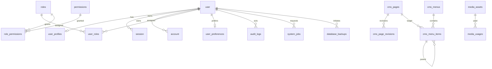

# BSD — Backend Schema Documentation

> **Architecture v2 (2026-11-14), target not implemented.** [Accepted ADRs](architecture/ADR/README.md) and [v2 Architecture Contracts](architecture/README.md) supersede contradictory v1 clauses. Preserve stable requirement IDs; see [v2 addendum](revisions/BSD-v2-ADDENDUM.md). Runtime source is still the static Next.js preview, not a completed full stack.

**ID:** BSD-1.0 | **Status:** Implementation baseline | **Database:** MySQL 8.4 / InnoDB / utf8mb4

## BSD-01 Database conventions

- App-owned IDs: UUID textual `CHAR(36)` unless a schema-specific compatibility reason is recorded. Auth IDs follow the **generated Better Auth schema**, including matching FK charset/collation/length.
- Application timestamps: `DATETIME(3)` in UTC, driver timezone configured UTC. `created_at` defaults or service-managed consistently; `updated_at` changes on mutation. Vendor auth timestamps follow auth-generated types.
- All optional properties explicitly `NULL`; all FK actions spelled out. No hand-editing applied migrations. `drizzle-kit generate` + `migrate` (not `push` in production).
- Native MySQL `JSON` for versioned structured settings/CMS data; Zod must validate stored JSON and all requests. JSON is not a replacement for FKs on stable relational entities.
- Page/user content is not a secret; **never** store raw passwords, tokens, database URLs or encryption keys in app settings or audit logs.
- 21 logical domain tables (four vendor auth and 17 app tables); Drizzle migration journal is internal and excluded.

## BSD-02 Core ER relationships



`cms_pages.published_revision_id` references a specific revision of the **same** page; navigation `page_id` FK is nullable for external links. Media usage's `(resource_type, resource_id)` is polymorphic and requires service-level validation. `verification` has auth-defined identifier lifecycle, not app foreign key.

## BSD-03 Vendor auth tables (4)

`user`, `session`, `account`, `verification`: **do not freeze columns manually**. Generate from the actual Better Auth version, chosen plugins and Drizzle MySQL adapter. Preserve generated PKs/indexes/unique constraints, and review any Admin plugin fields/tables before migration. Application may rely on canonical `user.id`, `user.email`, `user.name`, and session identity only after confirming the generated field schema. The reviewed schema-compatibility preflight must compare the generated schema against the pinned Better Auth version; there is no installer. Treat user deletion as application deactivation rather than removing vendor-owned records.

## BSD-04 App schema — all 17 tables

Notation: `PK`, `FK`, `UQ`, `NN` = primary key, foreign key, unique, not null. `actor_id` / `user_id` definitions use the exact auth user ID SQL type, not a blanket `CHAR(36)`. FK policies default `RESTRICT` unless explicitly stated. Store full before/after values only when redacted and safe.

### 1. `user_profiles`

| Column | Type | Constraints/default |
|---|---|---|
| `user_id` | auth-user-ID type | PK, FK `user.id`, NN, ON DELETE RESTRICT |
| `status` | VARCHAR(16) | NN, `invited` / `active` / `inactive` / `suspended`, default `invited` for ordinary provisioning; bootstrap Super Admin explicitly set `active` |
| `must_change_password` | BOOLEAN | NN default true for bootstrap; normal invited account policy defined separately |
| `authorization_version` | INT UNSIGNED | NN default 1 |
| `last_status_changed_at` | DATETIME(3) | nullable |
| `created_at` | DATETIME(3) | NN |
| `updated_at` | DATETIME(3) | NN |

INDEX `(status)` for admin filtering. All authorization-sensitive endpoints check status and forced password change; change status revokes sessions.

### 2. `roles`

| Column | Type | Constraints/default |
|---|---|---|
| `id` | CHAR(36) | PK |
| `code` | VARCHAR(100) | NN UQ, snake_case lower |
| `name` | VARCHAR(100) | NN |
| `description` | TEXT | nullable |
| `is_system` | BOOLEAN | NN default false |
| `version` | INT UNSIGNED | NN default 1, optimistic concurrency |
| `created_at` | DATETIME(3) | NN |
| `updated_at` | DATETIME(3) | NN |

System role `super_admin` reserved. Deleting non-system role with assignments is blocked until reassigned; `is_system` immutable through user DTO.

### 3. `permissions`

| Column | Type | Constraints/default |
|---|---|---|
| `id` | CHAR(36) | PK |
| `code` | VARCHAR(150) | NN UQ (`cms.pages.publish`) |
| `module` | VARCHAR(100) | NN |
| `action` | VARCHAR(50) | NN |
| `label` | VARCHAR(150) | NN |
| `description` | TEXT | nullable |
| `is_active` | BOOLEAN | NN default true |
| `created_at` | DATETIME(3) | NN |
| `updated_at` | DATETIME(3) | NN |

INDEX `(module,is_active)`. Sync deprecates missing codes; it does not hard-delete historic grants.

### 4. `user_roles`

| Column | Type | Constraints/default |
|---|---|---|
| `user_id` | auth-user-ID type | composite PK, FK user, NN |
| `role_id` | CHAR(36) | composite PK, FK roles, NN |
| `assigned_at` | DATETIME(3) | NN |
| `assigned_by` | auth-user-ID type | FK user, NULL for system bootstrap |

INDEX `(role_id,user_id)`. Deleting an app role only when unassigned; role link removed explicitly in user-role update. All assignments audited.

### 5. `role_permissions`

| Column | Type | Constraints/default |
|---|---|---|
| `role_id` | CHAR(36) | composite PK, FK roles, NN |
| `permission_id` | CHAR(36) | composite PK, FK permissions, NN |
| `assigned_at` | DATETIME(3) | NN |

INDEX `(permission_id,role_id)`. Role permission updates replace grants atomically, increment `roles.version`, authorization versions of affected users, audit within the same DB transaction. Super-admin granted semantics are protected by authorization service.

### 6. `cms_pages`

| Column | Type | Constraints/default |
|---|---|---|
| `id` | CHAR(36) | PK |
| `published_slug` | VARCHAR(255) | nullable UQ (canonical slash-leading URL) |
| `published_revision_id` | CHAR(36) | nullable, FK to revision of same page (see constraints below) |
| `archived_at` | DATETIME(3) | nullable |
| `created_by` | auth-user-ID type | FK user, NN |
| `updated_by` | auth-user-ID type | FK user, NN |
| `created_at` | DATETIME(3) | NN |
| `updated_at` | DATETIME(3) | NN |

INDEX `(updated_at)`, `(archived_at)`. `published_revision_id IS NULL` indicates not live; `published_slug` should be NULL when not live. MySQL CHECK constraint can enforce equivalence if supported/verified. Homepage slug `/` occupies published unique namespace only. To enforce same-page published pointer with FK: add `UNIQUE (page_id,id)` to revisions and `FOREIGN KEY (id,published_revision_id) REFERENCES cms_page_revisions(page_id,id)` after both tables exist; verify MySQL nullable FK semantics. Also validate in publishing service transaction. No cascade delete page revisions.

### 7. `cms_page_revisions`

| Column | Type | Constraints/default |
|---|---|---|
| `id` | CHAR(36) | PK |
| `page_id` | CHAR(36) | NN FK cms_pages |
| `revision_no` | INT UNSIGNED | NN |
| `slug` | VARCHAR(255) | NN, slash-leading candidate |
| `title` | VARCHAR(255) | NN |
| `template_key` | VARCHAR(100) | NN default `default` |
| `schema_version` | INT UNSIGNED | NN |
| `blocks_json` | JSON | NN, validated by CMS block registry |
| `seo_json` | JSON | NN, validated SEO object |
| `featured_media_id` | CHAR(36) | nullable FK media_assets |
| `created_by` | auth-user-ID type | FK user, NN |
| `created_at` | DATETIME(3) | NN |

UQ `(page_id,revision_no)` and `(page_id,id)` (for same-page pointer); INDEX `(page_id,created_at)`. Revision rows immutable; no update beyond explicitly permitted integrity repair tooling. Revisions may be inserted while page is archived only after restore action.

### 8. `cms_menus`

| Column | Type | Constraints/default |
|---|---|---|
| `id` | CHAR(36) | PK |
| `name` | VARCHAR(120) | NN |
| `location` | VARCHAR(50) | NN UQ (`header`,`footer` default seeds) |
| `created_at` | DATETIME(3) | NN |
| `updated_at` | DATETIME(3) | NN |

### 9. `cms_menu_items`

| Column | Type | Constraints/default |
|---|---|---|
| `id` | CHAR(36) | PK |
| `menu_id` | CHAR(36) | NN FK cms_menus |
| `parent_id` | CHAR(36) | nullable FK cms_menu_items, ON DELETE RESTRICT |
| `label` | VARCHAR(150) | NN |
| `link_type` | VARCHAR(20) | NN (`page`,`external`) |
| `page_id` | CHAR(36) | nullable FK cms_pages |
| `external_url` | VARCHAR(2048) | nullable, `https://` preferred; allow safe schemes only |
| `sort_order` | INT UNSIGNED | NN default 0 |
| `is_visible` | BOOLEAN | NN default true |
| `created_at` | DATETIME(3) | NN |
| `updated_at` | DATETIME(3) | NN |

INDEX `(menu_id,parent_id,sort_order)`, INDEX `page_id`. `page` link requires `page_id`; `external` requires URL and no `page_id`; service rejects cycles, cross-menu parent, depth >2. For page link use published slug when rendering.

### 10. `media_assets`

| Column | Type | Constraints/default |
|---|---|---|
| `id` | CHAR(36) | PK |
| `storage_disk` | VARCHAR(50) | NN (`local` initially) |
| `storage_key` | VARCHAR(512) | NN (opaque path/key) |
| `original_name` | VARCHAR(255) | NN |
| `mime_type` | VARCHAR(120) | NN, server-detected |
| `file_size` | BIGINT UNSIGNED | NN |
| `checksum_sha256` | CHAR(64) | NN |
| `width` | INT UNSIGNED | nullable |
| `height` | INT UNSIGNED | nullable |
| `alt_text` | VARCHAR(500) | nullable |
| `uploaded_by` | auth-user-ID type | NN FK user |
| `created_at` | DATETIME(3) | NN |
| `deleted_at` | DATETIME(3) | nullable |

UQ `(storage_disk,storage_key)`, INDEX `(created_at)`, `(deleted_at)`. Stored key never accepted from untrusted caller as filesystem path.

### 11. `media_usages`

| Column | Type | Constraints/default |
|---|---|---|
| `id` | CHAR(36) | PK |
| `media_id` | CHAR(36) | NN FK media_assets |
| `resource_type` | VARCHAR(80) | NN (`cms_revision`,`settings`...) |
| `resource_id` | VARCHAR(100) | NN |
| `revision_id` | CHAR(36) | nullable FK cms_page_revisions |
| `field_path` | VARCHAR(255) | NN |
| `created_at` | DATETIME(3) | NN |

UQ `(media_id,resource_type,resource_id,field_path)`, INDEX `(resource_type,resource_id)` and `(revision_id)`. Enforce polymorphic link integrity in domain services; reconcile broken references by scheduled read-only checks before removal.

### 12. `app_settings`

| Column | Type | Constraints/default |
|---|---|---|
| `key` | VARCHAR(150) | PK, allowed typed registry only |
| `value_json` | JSON | NN |
| `schema_version` | INT UNSIGNED | NN |
| `version` | INT UNSIGNED | NN default 1 |
| `updated_by` | auth-user-ID type | nullable FK user |
| `updated_at` | DATETIME(3) | NN |

Initial registered keys: `general` (`applicationName`, `shortName`, `description`, `locale`, `timezone`, `dateFormat`, `footerText`, `logoMediaId`, `faviconMediaId`), `appearance` (`activeThemeConfigId`,`defaultColorMode`). Unknown keys rejected; public API exposes only safe projection.

### 13. `theme_configs`

| Column | Type | Constraints/default |
|---|---|---|
| `id` | CHAR(36) | PK |
| `name` | VARCHAR(120) | NN |
| `preset_key` | VARCHAR(120) | NN UQ per installation |
| `tokens_json` | JSON | NN, light/dark semantics |
| `schema_version` | INT UNSIGNED | NN |
| `is_system` | BOOLEAN | NN default false |
| `created_at` | DATETIME(3) | NN |
| `updated_at` | DATETIME(3) | NN |

Seed protected preset `salt-and-pepper`. Optional user-defined themes require unique `preset_key`. Global selected theme referenced in `app_settings.appearance` (validated ID existence by service).

### 14. `user_preferences`

| Column | Type | Constraints/default |
|---|---|---|
| `user_id` | auth-user-ID type | PK FK user |
| `color_mode` | VARCHAR(10) | NN default `system` (`light`,`dark`,`system`) |
| `updated_at` | DATETIME(3) | NN |

### 15. `audit_logs`

| Column | Type | Constraints/default |
|---|---|---|
| `id` | CHAR(36) | PK |
| `actor_user_id` | auth-user-ID type | nullable FK user, null system actions |
| `action` | VARCHAR(150) | NN |
| `module` | VARCHAR(100) | NN |
| `resource_type` | VARCHAR(100) | nullable |
| `resource_id` | VARCHAR(100) | nullable |
| `old_values` | JSON | nullable, redacted |
| `new_values` | JSON | nullable, redacted |
| `request_id` | VARCHAR(100) | NN |
| `ip_address` | VARCHAR(45) | nullable |
| `result` | VARCHAR(16) | NN (`success`,`failure`) |
| `created_at` | DATETIME(3) | NN |

INDEX `(actor_user_id,created_at)`, `(module,created_at)`, `(action,created_at)`, `request_id`. App API append-only. Critical restore events duplicated to external protected journal.

### 16. `system_jobs`

| Column | Type | Constraints/default |
|---|---|---|
| `id` | CHAR(36) | PK |
| `job_type` | VARCHAR(80) | NN |
| `queue_job_id` | VARCHAR(150) | NN UQ (deterministic, namespaced) |
| `dispatch_state` | VARCHAR(16) | NN default `pending` (`pending`,`claimed`,`sent`), separate from execution status |
| `payload_json` | JSON | Nullable for existing-row migration; validated job references only, no secrets |
| `idempotency_key` | VARCHAR(150) | Nullable; UQ with `job_type` for non-null values |
| `dispatch_attempts` | INT UNSIGNED | NN default 0 |
| `next_dispatch_at` | DATETIME(3) | Nullable; retry eligibility |
| `dispatch_lease_until` | DATETIME(3) | Nullable; expired claims may be reclaimed |
| `dispatch_lease_owner` | VARCHAR(128) | Nullable; fencing conditional ACK to current dispatcher |
| `request_id` | VARCHAR(100) | Nullable; API/job correlation |
| `status` | VARCHAR(20) | NN queued/running/succeeded/failed/cancelled |
| `requested_by` | auth-user-ID type | nullable FK user |
| `progress` | TINYINT UNSIGNED | NN default 0 (0–100) |
| `attempt_count` | INT UNSIGNED | NN default 0 |
| `error_code` | VARCHAR(100) | nullable (no secret details) |
| `started_at` | DATETIME(3) | nullable |
| `finished_at` | DATETIME(3) | nullable |
| `created_at` | DATETIME(3) | NN |
| `updated_at` | DATETIME(3) | NN |

INDEX `(status,created_at)`, `(job_type,created_at)`, `(dispatch_state,next_dispatch_at)`, `(dispatch_state,dispatch_lease_until)`; UNIQUE `(job_type,idempotency_key)`. MySQL records durable job intent; Redis/BullMQ is conditional execution transport with at-least-once delivery. Production restore is never a job and cannot be retried by a worker.

### 17. `database_backups`

| Column | Type | Constraints/default |
|---|---|---|
| `id` | CHAR(36) | PK |
| `backup_type` | VARCHAR(20) | NN (`database`,`full`) |
| `storage_key` | VARCHAR(512) | NN UQ, protected location |
| `file_size` | BIGINT UNSIGNED | nullable until complete |
| `checksum_sha256` | CHAR(64) | nullable until complete |
| `encryption_key_id` | VARCHAR(120) | NN, key reference only |
| `schema_version` | VARCHAR(100) | NN, migration marker |
| `app_version` | VARCHAR(100) | NN |
| `manifest_json` | JSON | NN (source/media coverage, date, checksum metadata) |
| `status` | VARCHAR(20) | NN queued/creating/verified/failed |
| `created_by` | auth-user-ID type | nullable FK user |
| `created_at` | DATETIME(3) | NN |
| `verified_at` | DATETIME(3) | nullable |

INDEX `(status,created_at)`, `(created_by,created_at)`. Never persist raw encryption key. Verified archives must be checked via checksum and isolated restore before selection for production restore.

## BSD-05 Canonical permission registry

Each code below is one active registry entry; user-facing grouping aligns with four menu groups. `super_admin` is protected system role; ordinary roles need explicit grants.

| Group | Permission codes |
|---|---|
| Dashboard | `dashboard.view`, `dashboard.widgets.activity.view` |
| CMS Pages | `cms.pages.view`, `cms.pages.create`, `cms.pages.update`, `cms.pages.delete`, `cms.pages.publish`, `cms.pages.preview` |
| Media (optional) | `media.view`, `media.upload`, `media.update`, `media.delete` |
| CMS Navigation | `cms.navigation.view`, `cms.navigation.create`, `cms.navigation.update`, `cms.navigation.delete` |
| Users | `users.view`, `users.create`, `users.update`, `users.status.update`, `users.roles.assign`, `users.sessions.revoke` |
| Roles | `roles.view`, `roles.create`, `roles.update`, `roles.delete`, `roles.permissions.update` |
| General | `settings.general.view`, `settings.general.update` |
| Appearance | `settings.appearance.view`, `settings.appearance.update` |
| Backups (optional Operations) | `backups.view`, `backups.create`, `backups.verify`, `backups.download`, `backups.delete` — sensitive operations require reviewed approval; **no `backups.restore` business permission/route** |
| Audit | `audit_logs.view` |

Default role grants:
- `super_admin`: implicit all active permissions with critical re-auth; never make this implicit access user-configurable.
- `administrator`: eligible operational grants subject to limited delegation; **not** `backups.delete`, protected super_admin assignment or critical credential operations by default. Production restore is operator-only CLI, not an app permission.
- `content_editor`: dashboard.view, CMS pages view/create/update/preview/publish, media view/upload/update, navigation view/update.
- `viewer`: dashboard.view and CMS pages.view (may add access per project).

Assigning `super_admin` is a **protected capability** requiring existing super-admin + recent re-auth; merely having `users.roles.assign` is insufficient. Protected system role cannot be changed/deleted through generic role editor.

### Module registry contract

Static source-controlled manifest must provide `id`, `name`, `version`, `permissions[{code,label,module,action,description}]`, `navigation[{id,parentId,href,requiredPermission}]`, optional public CMS block definitions. Validate duplicate IDs/routes/codes at CI and sync; no automatic permission grants to ordinary roles. Removals become deprecated. Generate editor checkbox groups and navigation from registry, with role permissions as DB bindings.

## BSD-06 REST API design

Business prefix `/api/v1`, native auth prefix `/api/auth/*`. Authenticated GET `/me/permissions` requires valid active session; public route uses only published data. Prefix omitted in tables below for brevity.

### Users and RBAC

| Method | Route | Permission | Body/query notes |
|---|---|---|---|
| GET | `/users` | users.view | `page,limit,search,status,roleId` |
| POST | `/users` | users.create | `name,email,roleIds[]`; invitation/activation policy |
| GET | `/users/:id` | users.view | User DTO, never account secrets |
| PATCH | `/users/:id` | users.update | name/non-critical profile fields |
| PATCH | `/users/:id/status` | users.status.update | status, expectedVersion |
| PUT | `/users/:id/roles` | users.roles.assign + protected role rule | `{roleIds,expectedVersion}` |
| POST | `/users/:id/revoke-sessions` | users.sessions.revoke | reason optional |
| GET | `/roles` | roles.view | pagination/search |
| POST | `/roles` | roles.create | name/code/description/permissions[] |
| GET | `/roles/:id` | roles.view | role/grants/version |
| PATCH | `/roles/:id` | roles.update | name/description/expectedVersion |
| DELETE | `/roles/:id` | roles.delete | only unassigned, non-system |
| PUT | `/roles/:id/permissions` | roles.permissions.update | complete codes[] + expectedVersion |
| GET | `/permissions` | roles.view | active, grouped |
| GET | `/me/permissions` | authenticated | own grants only |

### CMS and navigation

| Method | Route | Permission | Notes |
|---|---|---|---|
| GET | `/cms/pages` | cms.pages.view | search, status, page, limit |
| POST | `/cms/pages` | cms.pages.create | create page + initial revision |
| GET | `/cms/pages/:id` | cms.pages.view | page + latest/published metadata |
| POST | `/cms/pages/:id/revisions` | cms.pages.update | immutable save with expectedRevisionNo/idempotency key |
| GET | `/cms/pages/:id/revisions` | cms.pages.view | paged history |
| GET | `/cms/pages/:id/revisions/:revisionId` | cms.pages.view | single revision |
| POST | `/cms/pages/:id/publish` | cms.pages.publish | revisionId, expectedPublishedRevisionId |
| POST | `/cms/pages/:id/unpublish` | cms.pages.publish | expectedPublishedRevisionId |
| DELETE | `/cms/pages/:id` | cms.pages.delete | archive, not hard delete |
| POST | `/cms/pages/:id/restore-revision` | cms.pages.update | fromRevisionId → new draft |
| GET | `/cms/menus` | cms.navigation.view | Header/footer config |
| POST | `/cms/menus` | cms.navigation.create | name/location |
| PUT | `/cms/menus/:id/items` | cms.navigation.update | full validated tree, expected version |
| DELETE | `/cms/menus/:id` | cms.navigation.delete | protected defaults policy |
| GET | `/public/pages` | public | `slug`, published only; cache-safe |
| GET | `/public/navigation/:location` | public | published targets only |

### Media, settings, operations

| Method | Route | Permission | Notes |
|---|---|---|---|
| GET | `/media` | media.view | paged/search |
| POST | `/media` | media.upload | multipart, validated content |
| PATCH | `/media/:id` | media.update | alt text and metadata |
| DELETE | `/media/:id` | media.delete | deny if published usage |
| GET | `/settings/general` | settings.general.view | admin typed config |
| PATCH | `/settings/general` | settings.general.update | allowlist partial update, version |
| GET | `/settings/appearance` | settings.appearance.view | active tokens/preset list |
| PUT | `/settings/appearance` | settings.appearance.update | validate contrast/version |
| GET | `/public/branding` | public | safe subset only |
| GET | `/me/preferences` | authenticated | self only |
| PATCH | `/me/preferences` | authenticated | self color mode |
| GET | `/backups` | backups.view | paged metadata |
| POST | `/backups` | backups.create | 202 job ID, scope database/full |
| POST | `/backups/:id/verify` | backups.verify | 202 job ID |
| GET | `/backups/:id/download` | backups.download | short-lived authorized download |
| DELETE | `/backups/:id` | backups.delete | retention/reference checks |
<!-- Production restore is CLI-only in v2; no POST /backups/:id/restore route. -->
| GET | `/system-jobs/:id` | permission derived from job type | user/type scope check |
| GET | `/audit-logs` | audit_logs.view | paged filters, redacted |
| GET | `/health/live` | limited public | no sensitive detail |
| GET | `/health/ready` | private/limited | dependencies with timeout |

`/api/auth/*` exclusively Better Auth, including password reset and sign-in; do not wrap its native responses. API OpenAPI schema must cover business endpoints only unless separately merging Better Auth's generated schema.

## BSD-07 DTO and error contracts

Successful item response:

```json
{"data":{"id":"550e8400-e29b-41d4-a716-446655440000","name":"Content Editor","code":"content_editor"},"meta":{"requestId":"req_123"}}
```

Paginated response:

```json
{"data":[],"meta":{"page":1,"limit":20,"total":0,"totalPages":0,"requestId":"req_123"}}
```

Error response:

```json
{"error":{"code":"PERMISSION_DENIED","message":"Insufficient permission","details":null},"meta":{"requestId":"req_123"}}
```

Status: `200` read/update, `201` create, `202` async job, `204` no content when appropriate, `400` malformed, `401` unauthenticated, `403` forbidden, `404` unavailable/not found, `409` conflict/optimistic lock, `422` domain validation, `429` rate limit, `500` unexpected, `503` maintenance. Create and update request DTO must not expose system flags or password hashes. `limit` default 20, max 100. Sort fields strictly allowlisted.

Example Zod role create (illustrative):

```ts
const CreateRoleSchema = z.object({
  name: z.string().min(3).max(100),
  code: z.string().regex(/^[a-z][a-z0-9_]*$/).max(100),
  description: z.string().max(2000).optional(),
  permissions: z.array(z.string()).default([]),
});
```

Role grant codes checked against registry and privilege of actor; type schema is not authorization. Cross-reference `AFD-03` and `TRD-04`.

## BSD-08 Key invariants and transaction boundaries

| Operation | Transaction and concurrency rule |
|---|---|
| Assign/delete system role | Lock affected role/user/super-admin population; prevent last-super-admin removal and self-elevation; audit with change |
| Replace role permissions | Compare expected version, replace grants, bump role & user auth versions, audit atomically |
| Create page and first revision | Insert page+revision in one transaction; no published pointer initially |
| Save draft | Insert immutable new revision; use expected revision/version to reject racing writes |
| Publish | Validate same-page revision, unique live slug, compare pointer; set pointer+slug and audit in transaction; public CMS SSR reads latest published pointer on next request (no persistent-cache invalidation in MVP) |
| Change navigation | Validate entire tree/cycles and save change atomically |
| Update settings | Compare version, typed validation, audit within transaction; invalidate cache after commit |
| Media upload | Prepare temp storage, DB commit; compensate failed storage changes safely |
| Create backup | Create async job and metadata robustly; reconcile queue enqueue failure |
| Restore | Exclusive lock and external journal; not guaranteed atomic; maintenance persists on failure |

## BSD-09 Seed/bootstrap and migration sequence

1. DB connection and Better Auth generated schema/migrations.
2. App schema migrations with FKs and check constraints.
3. Permission registry sync and system roles (`super_admin`,`administrator`,`content_editor`,`viewer`).
4. Seed Salt & Pepper theme and safe `general` / `appearance` defaults, Header/Footer menus.
5. Bootstrap an **operator-supplied** initial admin email using **private password input** via Better Auth-approved credential API, set `must_change_password`, assign `super_admin`.
6. Seed/idempotency verification; repeated bootstrap must not replace existing password or downgrade account role.

No hardcoded password or insecure fixed secret in code/repo/archive. Manual first-admin bootstrap requires a unique password; user-supplied development password must not become a universal production default. Check migrations in isolated DB before deployment and maintain pre-migration recovery path.

## BSD-10 Verification cases

- Apply all migrations to empty MySQL; verify table counts, FK, unique and indexes; migrate again idempotently.
- Duplicate permission/role code rejects; role assignment protects concurrency; disable blocks current sessions; users cannot self-elevate.
- Create draft/change title/slug never changes published snapshot; same-page pointer invariant enforced; duplicate publish slug rejects.
- Invalid JSON block version rejected; public only published.
- Parent menu cannot reference other menu or create cycle; external link rejects script URL.
- Media delete rejects referenced media; path traversal denied; rogue MIME rejected.
- Settings unknown key/unsafe theme rejected; audit contains no secrets.
- Backup job verifies checksum and staging restore; restore rejects corrupted archive and does not auto-retry.
- Contract tests verify Zod/OpenAPI errors and all documented response shapes.
## BSD-11 Architecture v2 schema/API deltas

**Keep the existing 21 logical tables (four Better Auth-generated + 17 application tables) and existing FK/data history.** The following target changes are additive, centrally migrated in a single Drizzle journal, and documented in [Database Contract](architecture/DATABASE-CONTRACT.md) and [BSD v2 addendum](revisions/BSD-v2-ADDENDUM.md):

- `user_profiles.status`: add `invited`; standard invitation defaults invited, operator's first administrator is activated separately.
- `permissions`: add `delegable BOOLEAN NOT NULL DEFAULT FALSE`, `sensitive BOOLEAN NOT NULL DEFAULT FALSE`; registry owns metadata and protected grants.
- `media_assets`: `status` pending/ready/failed/deleted, `visibility` public/private, `ready_at`; support safe backfill for existing verified files.
- `cms_page_revisions`: `save_key`, `request_hash`, UNIQUE(page_id,save_key), immutable idempotent writes; same-page published-pointer constraint remains.
- `system_jobs`: durable dispatch state, payload, lease owner/expiration, idempotency key, attempt count, next dispatch and indexes for safe replay.
- `database_backups`: offsite snapshot ID, offsite verified timestamp, verified restore timestamp and failure code. Do not make SQL state the sole offsite recovery catalog.
- `theme_configs`: immutable snapshots selected through typed versioned app setting; per-user light/dark/system preference remains separate.

**Registry:** canonical `media.*` codes replace legacy `cms.media.*`; migrate existing grants in a reviewed one-time step when necessary. `backups.restore` is CLI/operator approval, not an exposed business API. Add read-only `/api/health/subsystems` with no secrets; `/api/health/live` and `/api/health/ready` existing routes remain. API/permission/route surface disabled when static module off, **without conditional tables/migrations**.

These are implementation targets; generate schema from pinned dependencies and review actual MySQL migration SQL, not copy illustrative snippets into production.
