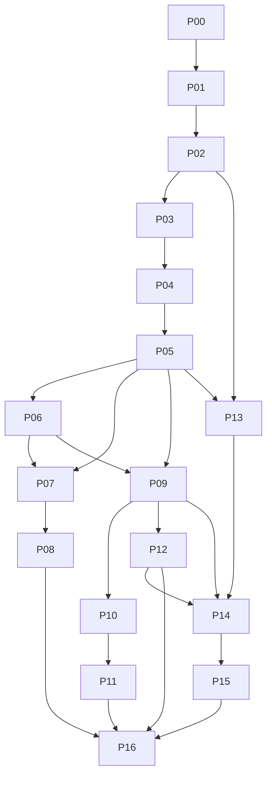

# IPD — Implementation Plan Documentation

**Status:** executable task-plan contract, not proof of completed features. **17 phases P00–P16**, `docs/agent/TASKS.yaml` authoritative for the count, IDs and dependencies. Reuse architecture: clone/manual setup, curated references, selected coding agent.

## IPD-01 Principles

Keep `main` and existing Next.js root scaffold, move into monorepo at P01. Every task ID has a scoped card, dependency, testable outcome and safe checkpoint. A task is not complete because documentation, files or a fixture exist.

Lifecycle: **RECOVER → REFERENCE → IMPLEMENT → TEST → VERIFY → PREVIEW → CHECKPOINT → NEXT**. Select one ready task, one domain [reference](references/REFERENCE-MAP.md); adapt a tested official library/pattern instead of wholesale starter copy. Source URL/version/license and exclusions must be recorded when code is imported. Do not add optional features to MVP automatically.

## IPD-02 Stable phase sequence and outcomes



This diagram is a high-level overview; **the exact `depends_on` edges in TASKS.yaml win**. Early web preview occurs at P00/P01 and is marked fixture, while authenticated shell completes at P06.

| Milestone | Phases | Deliverable |
|---|---|---|
| A | P00–P03 | Specs/reference playbooks, npm monorepo three apps, dev preview, MySQL/Redis integration |
| B | P04–P08 | Better Auth, protected RBAC/first admin **manual script**, authorized shell, user/role and dashboard |
| C | P09–P12 | Media, CMS editor, published pages/nav, settings/theme |
| D | P13–P16 | Worker, encrypted backup, staged restore, **manual clone/build/PM2/Nginx setup verification** |

## IPD-03 Atomic task and checkpoint

1. RECOVER actual task status, Git diff, scoped requirements and tested safe fixtures.
2. REFERENCE official package + at most one compatible source comparison, record license/version/expected adaptation and exclusions.
3. IMPLEMENT one end-to-end bounded responsibility; split oversized pending tasks using reviewed split plan, retaining parent integration checkpoint.
4. TEST scoped unit/integration/negative after last source edit; use disposable MySQL/Redis, no hidden skips.
5. VERIFY permission, rollback/idempotency and concurrency as appropriate; for `effective_risk: high`, independent qualified reviewer must approve before `complete`.
6. PREVIEW verified local route or read-only diagnostic, label fixture/integrated; user review queue separate from CLI status.
7. CHECKPOINT source hash, commit, tests, source attribution, blocked risks and next ready task.
8. NEXT continue independent safe ready task within current session; never imply background execution.

Technical states: `pending → in_progress → completed → verified`, with `blocked` when necessary. Phase gates require all child tasks completed and matching current-source test evidence. Human preview review does not promote technical status.

## IPD-04 Workstreams and agent assignment

All task implementations use **selected coding agent**. No High Reasoning model is required, including for auth/RBAC/backup/restore; those areas nevertheless demand **stronger negative/concurrency tests and independent review**. Reviewer independence is about different qualified review, not model-name or effort selection.

P00 docs, P01 monorepo, P02 local Lerd, P03 MySQL/Drizzle, P04 authentication, P05 app RBAC/admin bootstrap, P06 admin UI, P07 users/roles, P08 dashboard, P09 media, P10 CMS editor, P11 public CMS, P12 settings, P13 worker, P14 backup, P15 recovery, **P16 manual setup and deployment**.

## IPD-05 Dependencies and risk boundaries

- Auth schema generated from installed Better Auth version before reviewed Drizzle MySQL migration.
- Business API authorization is server-side; admin menu hiding is insufficient. Admin created only after roles/permission sync.
- CMS draft privacy, same-page published revision pointer and media reference safety maintained atomically.
- Worker idempotency, backup verification and restore isolation are required; never auto-retry restore.
- Production operations need explicit operator authorization. Tests never write to dev/shared/production DB by accident.
- No `apps/installer`, project generator, artifact release manager, release manifest/checksum/symlink switching workflow or Docker dependency.

## IPD-06 Evidence matrix

| Work category | Minimum proof |
|---|---|
| P00 docs | Graph/docs validation with actual repository state |
| P01–P03 | npm ci/build/launch, isolated service/DB checks, fixture/diagnostic preview |
| P04–P05 | Auth 401/403, session lifecycle, negative and concurrent last-admin cases, independent review |
| P06–P08 | Browser mobile/desktop, role-based navigation, real API data |
| P09–P12 | Upload denial, CMS draft isolation/publish, settings persist, role-gated operations |
| P13–P15 | Worker retry/replay, encrypted backup/checksum and disposable restore; independent review |
| P16 | Clone/manual setup, npm commands and their failure modes, PM2/Nginx smoke and rehearsed recovery, no installer |

## IPD-07 Manual clone and server setup

Target after scripts are implemented:
```bash
npm ci
# configure private .env, unique MySQL/Redis/storage first
npm run db:migrate:check
npm run db:migrate
npm run permissions:sync
npm run db:seed
npm run setup:admin
npm run setup:verify
npm run build
# review and start PM2 / Nginx manually
```

The **current** root Next.js has only `dev`, `lint`, `build`. These other scripts are **planned** and must be implemented/tested before use; docs do not make them executable. See [Manual Clone Setup](MANUAL-CLONE-SETUP.md) and [Server README](../README-SERVER.md).

## IPD-08 Manual update and recovery

Review/backup → test SQL migration in isolated MySQL → operator-approved migration → Git pull trusted commit → npm ci/build → PM2 restart → smoke test. A code rollback via Git does not undo a DB migration. No automated release/rollback service, versioned directory manager, destructive reset or auto-restore.

## IPD-09 Completion

All task gates verified with current source evidence, real UI/auth/RBAC/CMS/media/queue/backup/restore tests, standalone new-project clone setup tested, production PM2/Nginx instructions reproduced on isolated equivalent environment, reference license ledger maintained, no private data or hardcoded secret shipped.
