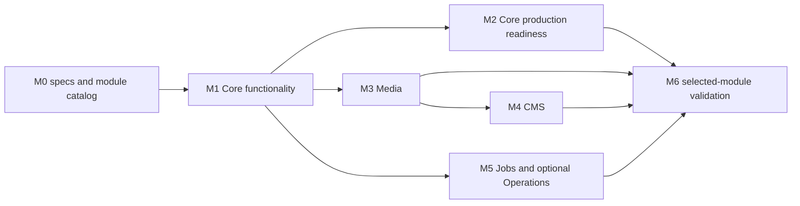

# IPD — Implementation Plan Documentation (Architecture v2)

**Approved design as of 2026-11-14, not yet implemented.** `docs/agent/TASKS.yaml` is authoritative for task IDs, statuses and dependency edges. The original 156 IDs remain; six new scoped prerequisites/certification tasks yield **162 planned tasks**, all pending until source tests/reviews pass.

## IPD-01 Principles

Build a clone-based single-tenant Modular Core using npm workspaces, Next.js Web and standalone Hono API with MySQL/Drizzle. Worker/Redis only for selected jobs-enabled modules. No installer, Docker or dynamic module toggle UI. Do not regenerate existing Next.js source. [Accepted ADRs](architecture/ADR/README.md), [Unified SPEC](../SPEC-001-app-starter-kit-modular-core.md), [Technical Contracts](architecture/README.md), [v2 IPD addendum](revisions/IPD-v2-ADDENDUM.md).

The active implementation loop is **RECOVER → REFERENCE → IMPLEMENT → TEST → VERIFY → PREVIEW → CHECKPOINT → NEXT**. One coding agent per bounded task/session (Codex, Claude, Antigravity, DeepSeek, etc.), model-neutral; independent high-risk review and production operator approval are separate.

## IPD-02 Core-first milestones and dependency graph

| Gate | Exact technical proof | Dependencies |
|---|---|---|
| M0 (specs) | ADR-001..016, v2 docs, module config contract, task graph valid | P00 and P01-10 |
| M1 (functional Core) | Hono/Next/MySQL, Better Auth, app RBAC, active/invited users, delegation/last-admin protection, dashboard | P03-10, P04, P05-10, P06–P08 |
| **M2 Core release** | Core-only web/API/MySQL, settings/theme/audit, independent encrypted backup + CLI recovery and manual CI/PM2/Nginx readiness, **without Redis/worker/Media/CMS/Operations** | **P16-11**, including relevant P12, P14-08 and P15 |
| M3 Media | safe LocalFs, private/public delivery, lifecycle and reference protection | P09-07 |
| M4 CMS | Media-certified, immutable revisions/idempotent save, published-only SSR and guarded preview | P11-07 |
| M5 Jobs/Operations | durable MySQL dispatcher and BullMQ replay; optional Operations backup status UI | P13-06 and P14-07 |
| M6 full starter | active-module configuration/certification matrix, recovery drill and clean-clone verification | **P16-12**, independent of earlier M2 readiness |

Phase numbers P00–P16 describe **historic workstreams** and do not require all optional-phase tasks to be completed before Core production readiness. DAG edges, not phase numbering, control execution.

## IPD-03 Atomic task and checkpoint

1. RECOVER actual current source/branch/task/working tree, safe fixtures and prior proof.
2. REFERENCE choose the [v2 Reference Index](references/INDEX-V2.md) and matching ADR/contracts; record upstream URL/version/license only when adapting code.
3. IMPLEMENT a bounded end-to-end slice and direct dependencies. Honor static module dependency guard, centralized migration and source import boundaries.
4. TEST real scoped unit/integration/negative, MySQL concurrency and recovery/Redis outage as relevant, after final edit. No production fixtures.
5. VERIFY behavior and relevant permissions/transaction side-effects; effective high-risk requires qualified **independent** review, not a particular model.
6. PREVIEW exact verified URL and fixture/integrated state, or a read-only terminal diagnostic with truthful limitations.
7. CHECKPOINT test evidence, source fingerprint, references, review result, task status and next ready task.
8. NEXT continue safe ready work; blocked high-risk review does not authorize self-approval.

State transitions remain in `agent_tasks.py`; user visual review is separate from technical verification and production approval.

## IPD-04 Technical workstreams

- P00/P01: accepted v2 docs, static module catalog `enabledModules` with dependency validation, monorepo web/API + optional worker.
- P02/P03: MySQL dev/test and 21-table centralized Drizzle journal; Better Auth schema generated from pinned version, Redis optional; no conditional migrations.
- P04/P05: invitation status, first-login enforcement, bounded role delegation, atomic audit, last-active-superadmin locking.
- P06–P08: Core admin and dashboard with disabled-module links/widgets suppressed.
- **Core prerequisite subset from P12:** typed general settings, immutable semantic themes, static fallback logo, per-user mode, audit. P12-03 Media branding is optional, not a Core blocker.
- **Core prerequisite subset from P14/P15:** independent backup + offsite manifest/restic/staging verification and operator-only independent recovery CLI; Operations API/UI is optional.
- **Core prerequisite subset from P16:** source clone, npm build, approved-SHA CI, Core-only PM2 web/API, Nginx/HTTPS, migration/seed/admin guards, backup/recovery drill. Optional worker build must not block Core.
- P09: Media independent certification, then P10/P11 CMS, and P13 Jobs/Operations separately.

## IPD-05 Security, migration and feature boundaries

Single Better Auth identity/session owner; single application RBAC owner. Delegation checks actor current grants, delegable/sensitive metadata, protected roles and self-elevation. Serialise all last-superadmin mutations via a consistent MySQL role-row lock order; transactional audit preserves history.

Static module map: Core always enabled, Media optional, CMS→Media, Operations→Jobs. Reject unknown/cycles/mismatches at startup. Disabled modules have no API/page/navigation/grants/OpenAPI; all database tables remain migrated in a single history. Optional worker/Redis must never break Core-only startup.

CMS uses save_key/request_hash/expectedRevisionNo immutable revisions; SSR public cache is not persistent for MVP. Jobs persist MySQL intent, leased dispatch and at-least-once idempotent worker execution. No HTTP or BullMQ production restore.

## IPD-06 Evidence and risk gates

| Track | Real acceptance evidence |
|---|---|
| Core | no-Redis web/API boot, DB schema version parity, Auth session/user states, 401/403, RBAC delegation and race tests, Pino/audit, Core settings |
| Media | private/public file tests, signature/dimension limits, pending→ready crash recovery, protected delete |
| CMS | Media dependency validation, immutable save replay/409, renderer version, publish/preview isolation and fresh SSR |
| Jobs | Redis outage, lease/replay after ack failure, no duplicated terminal side-effects |
| Core production | offsite backup freshness, recovery from empty staging, manual approved commit/CI, PM2/Nginx/HTTPS and Core-only smoke |
| Optional matrix | per-module config hash and separate certification, including invalid module combinations |

CI passing, documentation validation or a static preview does not prove application behavior. Independent review required for high-risk changes regardless of coding model.

## IPD-07 Manual clone and operator setup

After scripts are implemented (not currently available on initial Next.js root scaffold): `npm ci`, private env / unique MySQL, `npm run db:migrate:check`, `npm run db:migrate`, `npm run permissions:sync`, `npm run db:seed`, `npm run setup:admin` (operator-supplied email and secret), `npm run setup:verify`, `npm run build`, PM2 web/API and optional worker, Nginx same-origin.

See [Manual Clone](MANUAL-CLONE-SETUP.md), [Server Guide](../README-SERVER.md), [Operations Runbook](architecture/OPERATIONS-RUNBOOK.md). Production restore uses a **separate disaster-recovery CLI** capable of working when app runtimes fail; this is not an installer.

## IPD-08 Update, rollback and recovery

Automatic CI; manual production deploy from an approved commit SHA and reviewed migrations. Offsite recovery backup and staging drill before release, operator approval for destructive operations. Git source rollback does not roll back MySQL schema; never auto-retry recovery or silently alter database history.

## IPD-09 Definition of done

**Core may be production-ready after P16-11** only with Core proofs, independent security review, real offsite backup/recovery drill and manual deployment verification. **Complete reusable starter including optional modules** requires separately selected module gates and P16-12 certification. No task status promoted on document edit.
