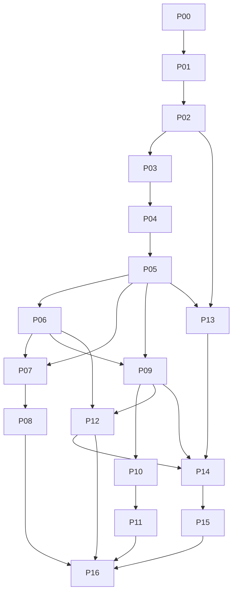

# IPD — Implementation Plan Documentation

**ID:** IPD-1.0 | **Status:** Executable specification (not executed) | **Phase count:** 17 (P00–P16) | **Milestones:** A–D

## IPD-01 Principles

The project is **not** one mega task. Divide work into phases, then atomic tasks that each have a stable ID, dependency list, scope, deliverable, implementation outline, test and restart checkpoint. A session may execute multiple ready tasks, but each task is committed/checkpointed individually when validated. No task can be `completed` because files were merely created.

The authoritative live registry is `docs/agent/TASKS.yaml`; this document contains the planning contract. Task-specific step-by-step guides live at `docs/agent/phases/Pxx-*.md`. Never mark test as passed if it was not run. The initial registry is all `pending` until coding begins.

## IPD-02 Milestones and phase dependency graph



**Parallelism:** Design token scaffolding and build smoke tests can start earlier; whole phase may contain tasks ready even if other tasks in its phase wait. `TASKS.yaml` edges, not diagram lines, are definitive. Preflight and package contract gates may overlap implementation, but release verification must happen last.

| Milestone | Phase | Deliverable/gate |
|---|---|---|
| A: Foundation | P00 Docs & Agent Setup | Source specs cross-referenced, task checker, checkpoint discipline |
| A | P01 Monorepo & Build Scaffolding | Fresh clone install, build pipeline outline, minimal artifact smoke |
| A | P02 Local Infrastructure | MySQL/Redis test connections, env validation, no production Docker |
| A | P03 Database Foundation | Vendor auth schema + migrations, audit base, repo transaction helper |
| B: Core | P04 Authentication | Better Auth login/reset/session + tests |
| B | P05 RBAC & Bootstrap | Registry/roles/authorization, initial admin idempotence, invariants |
| B | P06 UI/Admin Shell | Salt & Pepper tokens, responsive shell, permission-aware navigation |
| B | P07 User/Role UI | Users/roles APIs, permission matrix and security checks |
| B | P08 Dashboard | Widget registry, authorized statistics/activity |
| C: CMS | P09 Media Storage | Storage adapter, upload validation, media API/UI |
| C | P10 CMS Editor | Pages/revisions/block registry/editor and publish API |
| C | P11 Public CMS | Public renderer, nav, draft preview, SEO/revalidation |
| C | P12 Settings | Typed general settings, branding, theme, audit UI |
| D: Ops | P13 Worker | Queue abstraction, health, job status, retries |
| D | P14 Backup | Verified encrypted MySQL backup jobs and UI |
| D | P15 Restore | Staged validation, maintenance, recovery/runbooks and failure tests |
| D | P16 Release | Artifact build, installer, PM2, aaPanel Nginx, README-SERVER, E2E and upgrade |

## IPD-03 Atomic task procedure (required for every ID)

1. **Preflight:** locate task in `TASKS.yaml`; inspect dependency completion and task detail in `docs/agent/phases`; read scoped spec IDs; capture `git status` and prior test state.
2. **Plan short implementation:** identify 1 responsibility, expected modules/DTO, migration impact, test cases. Split oversized task before editing.
3. **Implement:** smallest coherent set of changes using existing contracts, no unrequested features. Use placeholders only in documentation, not production logic.
4. **Validate:** run targeted commands for affected package(s), negative API tests for auth/RBAC, migration test when schema changed. No unverified assertions.
5. **Checkpoint:** update task status with evidence and `CHECKPOINT.md`; record modified files/commit/tests/next ready task/blockers. Commit tested unit only if clean and policy permits.
6. **Continue:** select next ready task automatically. Never use destructive git/database commands to fix interrupted work.

### Task state machine

`pending → in_progress → completed → verified` ; `pending/in_progress → blocked` with reason. `blocked → in_progress` after blocker cleared. `completed` means scoped tests passed; `verified` means phase gate accepted. Do not mark `verified` before phase gate. For a phase with N tasks, gate completion requires all tasks at least `completed` and corresponding milestone tests.

### Session limit policy

- Favor small tasks with one testable outcome; no arbitrary timer/token quotas (agent capacity varies).
- Save **progress checkpoint** at task start, after meaningful stable work, before any risky operation; a **verified checkpoint** after tests.
- Do not rely on automatic background continuation. New session must validate Git diff and current DB migration state before resuming `in_progress` task.
- In incomplete task, state exactly what is implemented, what is not, which tests ran, error messages/safe references, and next command. Do not falsely mark completed.
- Automatically continue across safe tasks; require authorization only for production, irreversible or security-sensitive operations.

## IPD-04 Stable workstream families

| Prefix | Scope | Notes |
|---|---|---|
| DOC/P00 | Repository spec & task management | Lint docs/links/task graph |
| CORE/P01–P03 | Toolchain, build, MySQL schema | Exact version pin and migration owner |
| AUTH/P04 | Better Auth and sessions | No parallel hand-written credential store |
| RBAC/P05 | Protected system role + bootstrap | First user after migrations/role seed |
| UI/P06 | Theme and admin shell | Navigation register under four groups |
| USER/P07 | User and role screens | Deny unauthorized assignment |
| DASH/P08 | Widgets/statistics | Widget permission guards on API |
| MEDIA/P09 | Files | Private path & references |
| CMS/P10–P11 | Editor/public/nav | Immutable revisions and published pointer |
| SET/P12 | Branding & appearance | Typed settings and contrast |
| JOB/P13 | Worker infrastructure | Restore retry disabled |
| BAK/P14–P15 | Backup/restore | External journal, staged restore |
| REL/P16 | Build, package, install, docs | Artifact-only smoke gate |

## IPD-05 Dependency rules

- A task may proceed if and only if every declared dependency is `completed` or `verified` (and parent gate where explicitly required), and it is not blocked by environment conditions.
- Database migrations run only after the corresponding schema is merged and versioned. Better Auth generation before auth migration.
- Auth and RBAC must precede private admin features. `P05` includes initial admin bootstrap **after** permission/role seed.
- Frontend module screens require their API contracts and shell; do not fake production endpoints as completed.
- CMS public renderer must not read latest draft; it uses published revision only.
- Backup worker must work before backup UI is declared complete; restore stage follows verified backup.
- Release docs written after the scripts exist and have been tested; draft contents are requirements until then.

## IPD-06 Exact test expectations

### Atomic task checks

Examples of **target package scripts** once implemented:

```bash
npm exec -- turbo run typecheck --filter=@repo/api
npm exec -- turbo run lint --filter=@repo/api
npm exec -- turbo run test --filter=@repo/api
```

When a shared package changes, include its consumers. For database modifications: apply migration to a clean disposable MySQL database and test repeat execution. For APIs: positive/negative auth/permission and OpenAPI schema tests. For UI: component test, keyboard flow, accessibility and interactive behavior.

### Phase gates

| Phase category | Minimum verification |
|---|---|
| P00–P03 | Doc/task integrity, frozen install, bootstrap DB/migrate repeat, package graph |
| P04–P05 | Login/reset first-change, 401/403, revocation, concurrency last-super-admin, admin bootstrap idempotent |
| P06–P08 | Mobile/desktop/dark shell, user/role UI, effective grants, widgets filtered by backend |
| P09–P12 | Upload security, draft isolation, revision/slug conflict, preview secrecy, public rendering/SEO, branding/theme update |
| P13–P15 | Worker restart, queue reconciliation, encrypted backup, checksum, isolated restore, manual recovery failure |
| P16 | Clean install from artifact, update with backward-compatible schema, process restart, PM2/Nginx, release manifest verification |

See `docs/architecture/TEST-MATRIX.md` for tests linked to functional requirements. Do not require all E2E on each small code change. Full suite at milestone and release gates.

## IPD-07 Packaging contract and server artifacts

`npm run release:build` → web Next standalone (monorepo tracing) + Hono/worker/installer portable production outputs → migration files → manifest/checksums → artifact-isolated smoke → `.tar.gz`. `README-SERVER.md` included. Artifact excludes source, `.env`, private keys, initial password, backups, media and logs. Build OS/arch/Node ABI must match deployment target; native packages tested in target-equivalent Linux.

`release-manifest.json` includes project/version/commit, targetOS, targetArch, Node major, schema migration marker, entrypoints, component checksums, build timestamp and safe compatibility info. Do not store secrets. Agent must verify output layout rather than assuming standalone path.

## IPD-08 Fresh install / update / rollback

**Fresh:** upload → check SHA256/version/arch → extract to non-public releases dir → create shared/env/media/backups/logs → MySQL/Redis preflight → migration → permission sync → system seeds → bootstrap admin via protected password input → start API/worker/web PM2 → bind Nginx → SSL → health & login test → backup config.

**Update:** upload and verify → backup if migration risky → migration compatibility check → pause writes/workers when necessary → migrate → switch `current` → PM2 reload/restart → health tests → verify queue → finalize. Rollback code only if schema compatible; otherwise maintenance and operator-guided recovery. Never assert SQL import is atomic.

## IPD-09 Definition of done for entire project

Every task is `verified`; six document links/IDs consistent; all auth/RBAC deny cases, CMS published invariants, settings, backup/restore tests pass; clean local setup works; production artifact contains installer+README and functions without monorepo source; aaPanel steps reproduced; no secrets present; documentation reflects real implemented commands; migration/update and restore recovery protocols demonstrated in disposable testing; critical human approval gates maintained.

## v1.2 repository integration (approved 2026-10-29)

The existing repository `danangwijaya03/app-starter-kit` already contains a working **root Next.js 16.4.3 npm scaffold** with `app/`, `public/`, `next.config.ts`, `tsconfig.json`, `eslint.config.mjs` and root `package-lock.json`. P01 must move the **existing** app into `apps/web`, not run create-next-app again. Use npm Workspaces and one root package-lock. This documentation-only commit does not relocate the source or claim new features implemented. The target production deployment is non-Docker artifact upload to aaPanel/PM2.
