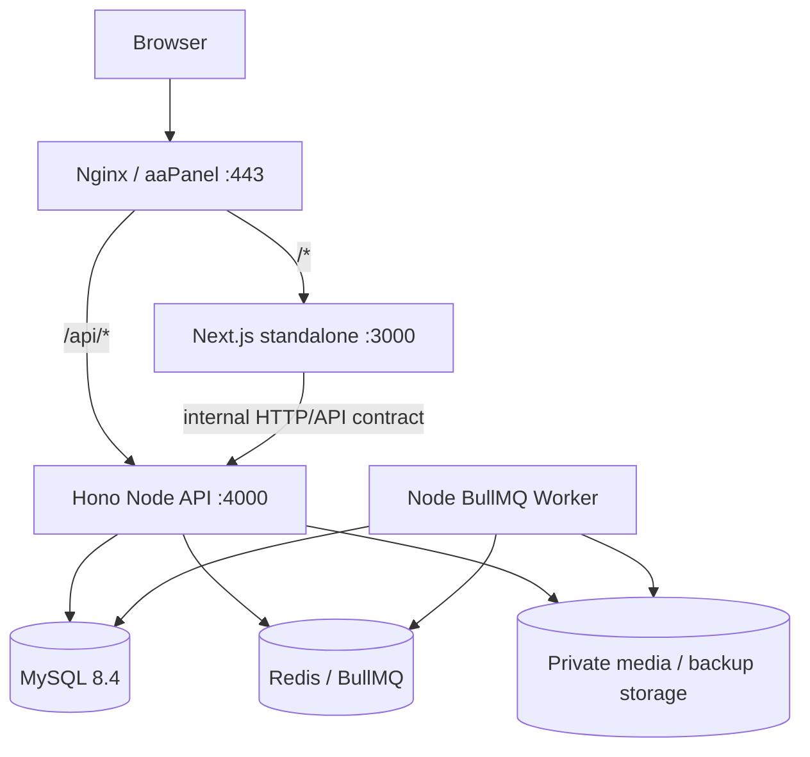

# TRD — Technical Requirements Document

**ID:** TRD-1.0 | **Date:** 2026-10-28 | **Status:** Implementation baseline

## TRD-01 Architectural decision

**Single-tenant modular monolith API within npm/Turborepo monorepo**. Next.js web, Hono API and BullMQ worker run as independent Node.js processes. A fourth installer CLI runs on demand. Runtime deployment on aaPanel + Nginx + PM2, MySQL/Redis native services; production uses precompiled, verified upload artifact, **no Docker**.



Nginx preserves original `/api/auth/*` and `/api/v1/*`. Browser receives same-origin session cookie, `Secure` over HTTPS, `HttpOnly` and appropriate `SameSite`; verify forwarded `Host` and `X-Forwarded-Proto`. API/DB/Redis ports bind private/loopback. CSRF defenses apply to unsafe authenticated browser operations; do not assume SameSite is the sole defense.

## TRD-02 Runtime/toolchain and pinning

- Node.js **24 LTS** baseline, exact patch pinned and tested; Corepack + npm exact pinned version; Turborepo; strict TS.
- Next.js App Router with Server Components by default; client components only where interactivity required; no Next static export.
- Hono on Node.js; `@hono/zod-openapi` for business API schemas and documented responses.
- MySQL 8.4 LTS InnoDB and Drizzle + mysql2; Better Auth Drizzle adapter configured for MySQL. Generate Better Auth schema from installed version. Drizzle exclusively owns migrations.
- Redis + BullMQ for serialized jobs; PM2 manages standalone web/API/worker.
- UI: Tailwind CSS v4, shadcn/ui, Aceternity UI free components (subject to licensing), Lucide, Motion, TanStack Table, React Hook Form + Zod, Tiptap.
- Vitest for unit/integration and Playwright for end-to-end; ESLint, TypeScript, format/lint in CI.
- Lock actual dependency versions during P01; upstream API changes require tests and ADR entry; no unverified `latest` in release builds.

## TRD-03 Source layout and boundaries

```
apps/
  web/src/{app,features,components,hooks,lib}/
  api/src/{modules,middleware,lib}/
  worker/src/{jobs,processors}/
  installer/src/{commands,services}/
packages/
  database/{src,schema,migrations}/
  contracts/src/{common,users,rbac,cms,media,settings,backups}/
  permissions/src/
  ui/src/
  cms-blocks/src/{registry,schemas,components}/
  storage/src/
  utils/src/
  config/
infra/{scripts,nginx,pm2}/
```

Constraints:
- `apps/web` **cannot** import DB driver, API service/repository or server secrets. Render via typed HTTP client / API contract.
- `apps/api` cannot import React/UI components; `apps/worker` shares server-safe services and DB but not web.
- `packages/database` owns DB schema/migrations only. `packages/contracts` holds public DTO/Zod schema; no database client. `packages/permissions` owns immutable codes/metadata.
- `packages/cms-blocks` may expose browser-safe renderer and schemas via separate exports; server must not import React into worker.
- No cyclic package imports. Use explicit exports; test production bundle of each app.
- `apps/api` module structure: route → auth → authorization → Zod → controller → service → repository → DB; services own business invariants.

## TRD-04 Authentication / authorization

- Mount Better Auth `auth.handler(c.req.raw)` on `/api/auth/*` before catch-all handlers. Core Better Auth response shape is not wrapped in app response envelope.
- Disable public signup. User invitation/password reset uses short-lived one-time mechanism. User is active only after server-side profile status check. Avoid separate custom password hashing implementations.
- RBAC roles and grants are custom app tables; user can hold multiple roles; allow-union, deny-by-default. Protected system `super_admin` implicit access to all active registered permissions; cannot remove or disable last active holder.
- Every protected API has policy permission, not just hidden navigation item. Sensitive actions need recent re-auth and audit.
- Permission registry validated on startup/CI; schema synchronizer command `permissions:sync --check|--apply` is controlled/idempotent. Missing codes fail CI. Newly registered permissions are not automatically granted to ordinary roles.
- To prevent stale grants, check DB per protected request at launch; optimize with authorization version/cache invalidation later only after correctness verified. Disable potentially stale auth cookie session cache for MVP or explicitly prove revocation correctness.
- Invariant enforcement uses transaction + locking or tested alternative; prohibit self-escalation and unauthorized assignment of system roles.

## TRD-05 Database, transactions and migrations

- InnoDB utf8mb4, UTC instants stored with `DATETIME(3)` for app tables. Vendor Better Auth schema uses exact installed generator output.
- PK: UUID `CHAR(36)` for app-owned entities, auth-ID columns must exactly match generated Better Auth ID type/length.
- Use NOT NULL, FK, unique, and query-specific indexes in BSD; money/business add-on data not part of starter kit.
- `cms_pages.published_revision_id` references a revision of the same page and pointer changes in transaction; enforce with composite FK where practical + service validation. `published_slug` unique and changed only on publish.
- `user_roles` and `role_permissions` use composite unique/PK; update role assignments atomically with protection check and audit.
- Drizzle `generate` and `migrate` only; do not run `drizzle-kit push` in production; migrations checked into Git and packaged in artifact.
- No assumption MySQL DDL is fully transactional. Run migration gate before release cutover; require compatibility or maintenance. Never auto-drop production schema.
- Seed registry/system roles/theme idempotently. Admin bootstrap after role seeds, with secret input, no password override if account already exists.

## TRD-06 Public frontend, CMS and caching

- Next.js Server Components render published pages using published revision only; draft preview requires authorized server-side session and short-lived signed authorization, never exposed to public caching.
- Block registry: `key`, `version`, Zod props schema, default props, renderer, editor. No arbitrary JSX/JS scripts stored in DB. Rich text sanitized both on input and render. Unknown block type/version renders controlled fallback + monitoring, not arbitrary code.
- Revisions immutable, at least one new revision on intentional save; avoid accidental duplicate autosave versions if editor retries (idempotency/expected revision).
- Page publish invalidates exact public paths/tags **after successful DB commit**; include old slug and new slug. Ensure public CDN/browser cache not serving stale drafts.
- Admin is interactive, TanStack Query where beneficial; public routes default SSR/appropriate revalidation. Runtime branding changes do not require rebuild.

## TRD-07 Media and storage

- Interface `StorageAdapter`: `put`, `get/readStream`, `delete`, `exists`, `signedReadUrl?`, `stat` and sanitized key metadata. MVP `LocalFsAdapter`; future S3 adapter.
- Private uploads under server `shared/media`, not under release or public web root. Public media served via controlled API/static delivery mechanism that never maps arbitrary user paths to filesystem.
- Validate file size, extension allowlist, actual magic signature/MIME, dimensions and ownership; randomized stored object keys; prefer server-generated thumbnails; reject executable/svg in MVP unless sanitized policy explicitly added.
- Prevent delete while live revisions or settings reference file. Use `media_usages` + reconciliation; reference changes and DB updates transact; eventual file garbage collection is safe and auditable.

## TRD-08 Settings and theme

- Typed registry of allowed keys; Zod validation on every update; no arbitrary string keys accepted by general settings.
- Salt & Pepper defaults: #FFFFFF, #D4D4D4, #B3B3B3, #2B2B2B; theme configs include light/dark semantic tokens, checked contrast; `light|dark|system` preference per user.
- `NEXT_PUBLIC_*` is fixed at build time; browser APIs use relative same-origin `/api/v1`. Server runtime supplies safe public branding snapshot and invalidates cache on update.
- Secret configs (DB connection, auth secret, signing keys) only in env/secret manager, never DB-editable settings UI.

## TRD-09 Worker, backup, restore

- One API enqueues background job; worker executes asynchronously. Jobs include owner, type, status, progress, requestId; protect job reads by permission and owner/type.
- Backup job: exclusive resource lock where appropriate, consistent MySQL dump for InnoDB (`--single-transaction --quick`) with DDL-free window, manifest with schema/app/version/media coverage, checksum, encryption and protected storage. MySQL grants least-privilege and secret never appears as command arg/log; supply credentials via protected option file.
- Full backup must include referenced media (or explicitly warn that DB-only archive cannot restore media). Offsite copy recommended for real production.
- Restore: re-auth + privilege, managed verified archive only, staging restore to separate DB, manifest/version check, pre-restore recovery backup, external append-only journal, maintenance/drain workers, restore under operator-controlled recovery, validate, session reconciliation, exit maintenance. **No automatic retry**, no promise of atomic SQL import/automatic rollback.
- Redis persistence alone is not recovery system; idempotent jobs and reconciliation prevent unintended repeats across restart.

## TRD-10 Observability and protection

- Structured logs with request ID/correlation ID, no passwords/credentials/PII by default; audit events with minimal redacted before/after values.
- Health: `/api/health/live` (no dependencies), `/api/health/ready` (DB/Redis probes with timeouts, private/limited) and web `/health`; worker heartbeat in jobs/ops.
- Rate limit login, credential reset, invitations and sensitive endpoints; server-side pagination max `limit` (e.g. 100); body/file limits.
- Security headers, CSP where compatible, anti-CSRF, HTTPS and secure cookies, timing-safe token validation, URL safety for nav/SSRF prevention, media malware-policy.
- Basic deployment backups: limited disk permissions and offsite copy, audit immutable from application API.

## TRD-11 Build and production artifact

Use `output: 'standalone'` on Next.js; set monorepo file-tracing root and include `public` and `.next/static` in normalized output. Compile API/worker/installer and make portable production runtime using compatible bundling/`npm-compatible runtime packaging` (verify exact pinned npm behavior). No source repo or package-manager install needed on server.

**Artifact contract:** `web/`, `api/`, `worker/`, `cli/`, `database/migrations/`, `config/`, `README-SERVER.md`, `release-manifest.json`. API/web/worker are separate PM2 processes; API on 127.0.0.1:4000, web on 127.0.0.1:3000; worker no public port. Nginx same-origin routing to both, env file per service in server `shared/env/`, data under `shared/` outside public root, versioned `releases/<version>` plus `current` symlink.

**Build compatibility:** target OS, architecture, Node runtime/ABI and native deps tested on target-equivalent Linux. Distinguish compile, pack, manifest checksum, isolated smoke, and fresh-install gates. Build assets do not include `.env`, installer secrets, private media, logs, backup or user data.

## TRD-12 Testing strategy and CI

- Per atomic task: affected package typecheck/lint/unit/integration only; expand tests for shared-contract/auth/RBAC/migration changes.
- Phase gate: relevant E2E, API contract tests, negative permission tests, concurrent admin/role invariant tests, media upload rejects, public draft privacy tests.
- Release: clean install, migration, seed idempotence, first login forced password change, worker job, CMS publish, backup/restore in disposable isolated DB, update, compatibility/rollback, server README reproduction.
- CI cannot mark test skipped due to missing secret as passed; use disposable ephemeral test DB and documented environment gating.

## TRD-13 Deployment policy and rollback

- Production installation: upload archive → manifest/checksum verification → unpack new release → connect shared env/storage → DB backup/migration gate → migration+seed+bootstrap (first install only) → PM2 launch/switch → healthcheck → finalize.
- Application rollback via `current` symlink only if migration backward compatibility established; if DB schema incompatible, maintenance and operator-directed recovery required.
- Do not execute production mutations automatically by coding agent. Actual deployment instructions must be validated and kept up to date with release CLI.

## v1.2 repository integration (approved 2026-10-29)

The existing repository `danangwijaya03/app-starter-kit` already contains a working **root Next.js 16.4.3 npm scaffold** with `app/`, `public/`, `next.config.ts`, `tsconfig.json`, `eslint.config.mjs` and root `package-lock.json`. P01 must move the **existing** app into `apps/web`, not run create-next-app again. Use npm Workspaces and one root package-lock. This documentation-only commit does not relocate the source or claim new features implemented. The target production deployment is non-Docker artifact upload to aaPanel/PM2.
