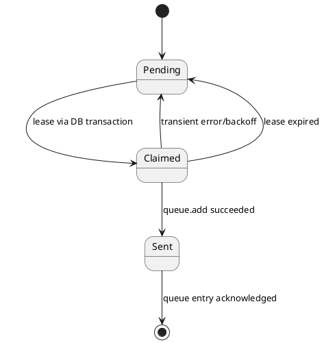

# Durable Job Dispatch & Optional Worker Contract — v2

## Scope

Redis/BullMQ and worker are optional **unless** at least one enabled module requires async processing. Operations UI requires Jobs capability; simple Media/CMS can operate synchronously within strict resource limits. Core API must boot with no Redis env configured when jobs aren't required.

### Job state model

`system_jobs.status`: `queued/running/succeeded/failed/cancelled`.
`system_jobs.dispatch_state`: `pending/claimed/sent` (delivery state distinct from processor outcome).
`queue_job_id` is stable deterministic namespaced ID derived from DB primary key (verify BullMQ supported characters and use safe format).
`payload_json` references owned objects and contains no credentials.
Unique `(job_type,idempotency_key)` for non-null keys; requests with identical key and mismatched hash must 409 (persist payload fingerprint in canonical request representation or validated payload field if schema evolves).

### Dispatcher state machine

On API request, atomically commit domain change + `system_jobs(pending)`; API returns 202 `jobId` only after DB commit. Claim with `FOR UPDATE SKIP LOCKED`, commit lease (`dispatch_lease_until`), then queue.add outside DB transaction. On success mark sent conditionally for matching persisted `dispatch_lease_owner`/lease, using a fencing token or equivalent tested mechanism so a stale dispatcher cannot ACK a later claim. If dispatcher crashes after successful Redis add but before DB mark sent, it may resend; **never claim exactly-once**. BullMQ duplicate job ID protection expires after removal, so processor must enforce idempotency with durable state/effects.

### Worker processor safety

1. Claim job execution in MySQL via compare-and-set on nonterminal state, record attempt and heartbeat/lease; use bounded work timeout.
2. Check job still enabled, validated job_type/payload, resource ownership and permissions applicable at execution time.
3. Apply domain mutation inside DB transaction with unique business idempotency record/constraint where relevant; external side effects use provider idempotency key or compensate with reconciliation.
4. On final success update `system_jobs.status=succeeded` transactionally with results and audit; repeat delivery of terminal job performs no new effects.
5. On transient error, BullMQ exponential backoff; exhaustion → failed, no secret error strings; manual retry only if processor declares safe.

Processor isolation: media thumbnail retry up to 3 times (concurrency 2 initial), cleanup 3 (concurrency 1), backup at most 2 safe retries, **production restore never queued/auto-retried**. Every retry policy is configurable and verified by tests; one VPS default worker=1 process.

Redis: private network, durability/AOF and non-eviction policy, alert if disconnected. Redis outage marks job subsystem degraded; Core liveness/readiness stay healthy if no Core dependency fails. For queued intent accepted while Redis down, dispatcher must recover when service returns. PM2 worker graceful close, lease expiry and replay test.

### Failure matrix

| Failure | Recovery |
|---|---|
| MySQL intent commit succeeds, Redis down | pending DB row; retry dispatch |
| Redis enqueue succeeds, DB acknowledgment lost | resend safe; idempotent processor |
| Worker killed during run | lease recovery; processor idempotent |
| Duplicate HTTP request | unique key + payload comparison |
| Job disabled by module change | fail closed; cancel/reconcile queued jobs |
| Backup partial artifact | cleanup manifest/temporary files before safe retry |
| Restore request replay | never allowed as job; use independent CLI |

### Required metrics/tests

`pending_jobs`, oldest pending age, dispatch failures, worker heartbeat, stale claims, failed jobs, processor side-effect uniqueness. Simulate Redis outage, MySQL transient failure, duplicate `queue.add`, worker crash before/after side-effect commit, and module disable with pending jobs.
