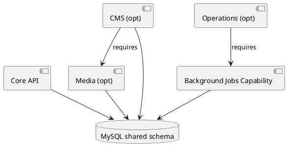

# Module & Dependency Contracts — v2

## Canonical module categories

| Layer | Included | Runtime |
|---|---|---|
| Core | Auth, RBAC, users, settings, audit, dashboard, health, API contracts | Web + Hono + MySQL |
| Media (optional) | Upload, delivery, media metadata, usage tracking | Web/API + LocalFs |
| CMS (optional) | Blocks, revisions, menus, published renderer | Depends on Media |
| Operations (optional) | Jobs dashboard, backup management/verification | Depends on Jobs |
| Shared infrastructure | Independent backup CLI and external monitoring | Always for production, outside runtime module flags |

Never put `core` in `enabledModules`; Core is unconditional. `media`, `cms`, and `operations` are statically enabled and validated at build/start. `jobsRequired = enabled.operations || anyEnabledModule.requiresJobs`. Other optional business modules can declare this capability without requiring Operations UI.

### PlantUML dependency flow



`moduleCatalog` is **checked-in source**, not user-defined JS loaded from database. Validate unknown key, dependency closure, cycles, and required environment. Web + API must share a build-consistent `MODULE_CONFIG_HASH`, exposed to deployment preflight (not secrets). For unrecognized or inconsistent config, fail build/start rather than silently enabling features. Disable means: unmount API, Next route 404 by server guard, hide navigation, omit OpenAPI path, make permission ineffective, and fail closed on disabled module's worker processors. No DB table deletion.

### Example configuration

```ts
// packages/config/src/module-catalog.ts
export const moduleCatalog = {
  media: { requires: [], jobs: false },
  cms: { requires: ["media"], jobs: false },
  operations: { requires: [], jobs: true },
} as const;

// packages/config/src/modules.config.ts
export const enabledModules = {
  media: false,
  cms: false,
  operations: false,
} as const;
```

Use checked `satisfies Record<ModuleId, boolean>` for the enabled map, runtime validation, and dependency test. Compile-time TypeScript does not replace env validation.

## Allowed package dependencies

| Source | Allowed | Forbidden |
|---|---|---|
| `apps/web` | `contracts`, `ui`, client-safe `config`, `cms-blocks/renderer` | `database`, `api/*`, `worker/*`, server secrets |
| `apps/api` | `contracts`, `permissions`, `database`, `storage`, `observability`, `cms-blocks/schemas` | `web/*`, editor/renderer React |
| `apps/worker` | server-side domain services, `database`, `storage`, `observability` | Hono route handlers, web, React |
| `packages/contracts` | Zod + simple static types | database/Node SDKs/React |
| `packages/permissions` | static metadata and pure policy functions | DB queries, UI |
| `packages/database` | Drizzle, MySQL, schemas, migrations | runtime module config, UI |
| `packages/cms-blocks/schemas` | Zod | React, editor-only libraries |
| `packages/ui` | React UI primitives and tokens | DB and secrets |

Business logic shared by API/worker belongs in a clearly named **server-only** package; never in browser-safe contracts. Package `exports` exposes subpaths intentionally. ESLint validates forbidden imports and circular dependencies. Worker and API never import Next route module by side effect.

### Module lifecycle

1. Developer changes checked-in config, reviewed PR and CI.
2. CI validates module graph and builds Web + API with same hash.
3. Production preflight checks env, DB schema, and active module certification.
4. `permissions:sync --check` computes grants being lost; operator approves `--apply`.
5. Transactional sync revokes `role_permissions` for disabled modules, records audit and increments affected users' authorization version. Existing nonactive grants also fail effective-permission check **before sync**.
6. Start Web + API, conditional worker; smoke test disabled routes/permissions. Re-enable **does not auto-grant** permissions.
7. Optional module deactivation preserves data. Physical cleanup is separate operator-approved process.

Admin menu `Dashboard / Manage Content / Manage User / Setting` is an optional UI presentation grouping, not hardcoded permissions. Empty sections must be hidden. CMS public menus independent of admin menu.
